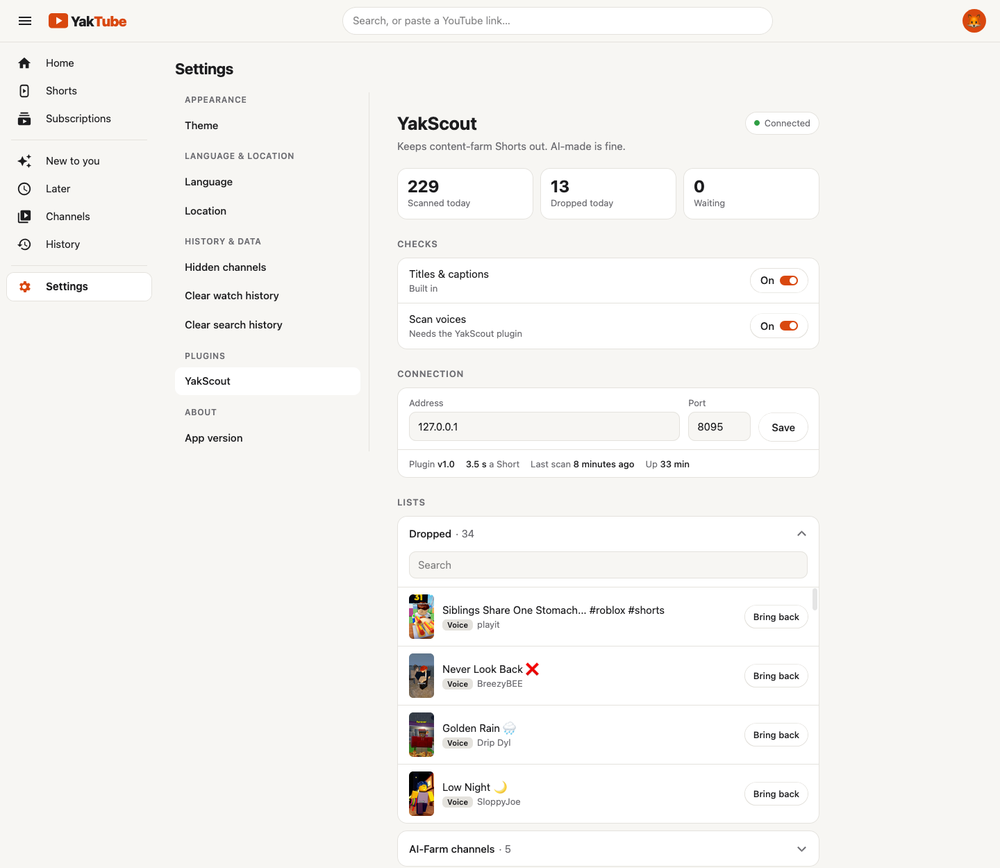
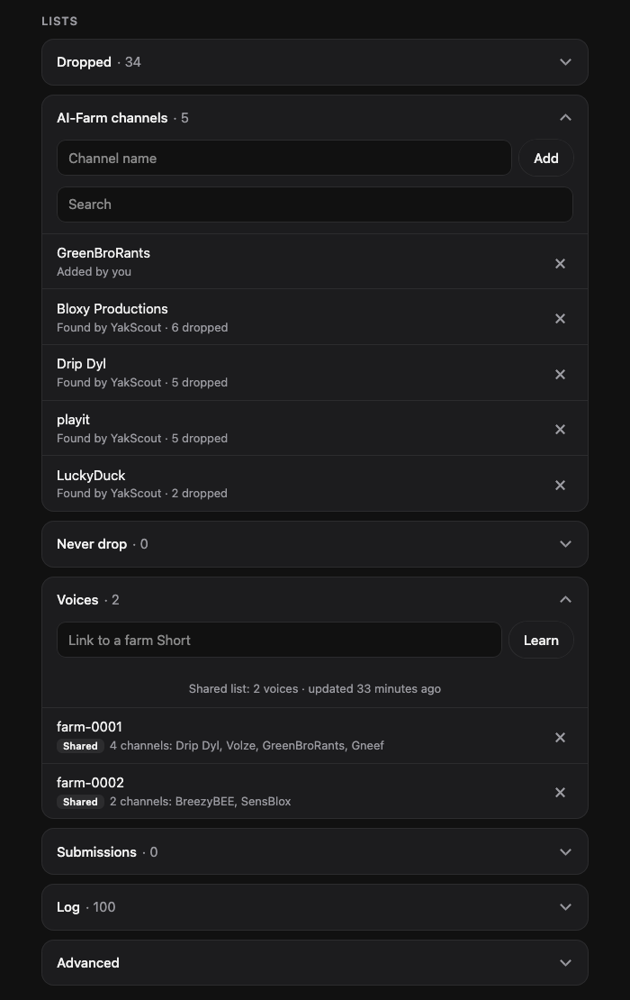
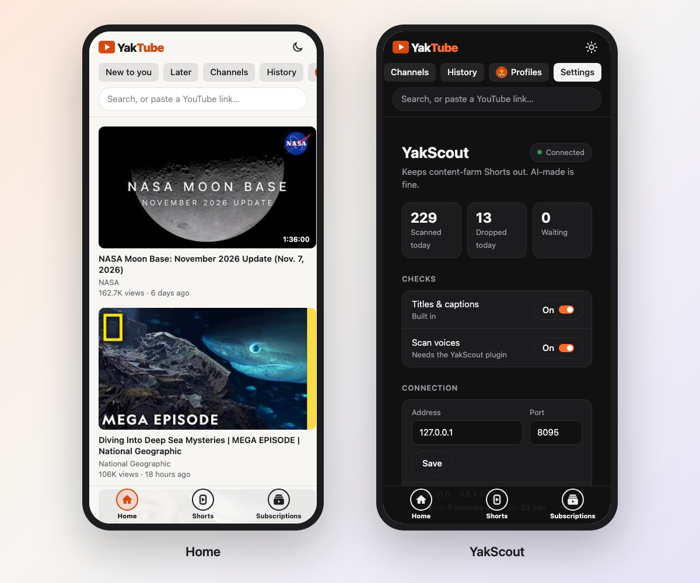

# Scout


*Scout's page in YakTube (computer, light theme): connected, scanning about 3 seconds a Short, and the farm Shorts it
caught, each with what gave it away (here, the voice) and **Bring back**.*

## 1. Overview & Purpose

- **What it is:** an optional companion service for [YakTube](https://github.com/glenndall/yaktube) that finds and
  filters out content-farm Shorts: the faceless channels that churn out Shorts from one formula, with the same
  synthetic voice, to farm views and ad revenue. Being made with AI isn't what it looks for (people make clever, funny
  things with AI); the repeated formula is.
- **How it works:** YakTube reviews each Short's title, description and captions; Scout listens to its audio and
  adds what it hears to YakTube's score.
- **Flexibility:** Scout runs on its own, in Docker (on a NAS or server) or directly on a Mac or Ubuntu machine.
  YakTube works normally while Scout is offline, and Scout catches up when it's back.

| | |
|---|---|
|  |  |
| **The lists** (computer, dark): AI-Farm channels it found, and the shared list of farm voices | **On a phone:** YakTube's Home (light) and the Scout page (dark) |

*Screenshots use demo data.*

## 2. How the Audio Analysis Works

For each Short, Scout fetches only the first 15 seconds of the original audio (about 80 KB, never one of YouTube's
AI-dubbed tracks) and runs three steps:

1. **Speech check:** someone must actually be talking (at least 15 words in YouTube's automatic captions for those
   seconds), so music on its own is left alone.
2. **Voiceprint:** a speaker-recognition model (CAM++ from 3D-Speaker) turns the voice into a voiceprint, fed in
   2-second pieces and averaged.
3. **Comparison:** the voiceprint is compared with the farm voices Scout has learned, and with the shared list of
   farm voices other people found ([scout-voices](https://github.com/glenndall/scout-voices), downloaded once
   a day).

About 2 seconds a Short on a 2020 MacBook, about 3 on a Synology DS220+. yt-dlp is only a backup for when YouTube
won't hand the audio over directly.

**Scoring & thresholds**

| Scout heard | Points |
|---|---|
| A learned farm voice | +35 |
| A learned farm voice heard on 2 or more channels | +50 (drops a Short by itself) |

YakTube adds these to its own score and drops a Short once the total reaches 50 (`YAK_SCOUT_MIN`, or **Drop at** in
YakTube's settings).

**How sure is it?** Tested on 131 Shorts (Nov 2026): farm Shorts sharing a voice came out 0.05-0.20 apart, every other
Short 0.73 or more from them, against a match limit of 0.25. Learning 7 farm Shorts caught 6 of the 8 other farm
Shorts in the set and 4 more found among the rest, and none of 37 ordinary Shorts. Still a small sample: check the
log, and if a voice catches the wrong Shorts, forget it.

## 3. Installation & Deployment Options

**Docker (Synology NAS or any server)**
1. Copy `Dockerfile`, `docker-compose.yml`, `scout.py`, `get_model.py` and `voices.json` into a folder of their own,
   e.g. `/volume1/NAS/yakscout`.
2. Inside it, create an empty folder named `data` (File Station → Create folder). Container Manager won't start the
   project without it; learned voices live there.
3. Synology: Container Manager → Project → Create → pick the folder → it finds `docker-compose.yml` → Next → Done.
   Elsewhere: `docker compose up -d --build` in the folder. The first start builds the image, which takes a few
   minutes (it downloads Python's libraries and the 29 MB voice model). The container shows **Healthy** once
   Scout answers on port `8095`.

Scout and YakTube can start or restart in any order: until Scout answers, YakTube shows **Can't reach** and
tries again every minute. To update Scout, replace `scout.py` and restart the project; rebuild (Action → Build)
only for a new `Dockerfile` or to bring yt-dlp up to date.

**macOS (standalone)**
```bash
python3 -m venv .venv
.venv/bin/pip install -r requirements.txt
.venv/bin/python get_model.py
```
Optional backup downloader: `curl -L -o .venv/bin/yt-dlp https://github.com/yt-dlp/yt-dlp/releases/latest/download/yt-dlp_macos && chmod +x .venv/bin/yt-dlp`

**Ubuntu (standalone, without Docker)**
```bash
sudo apt install python3 python3-venv ffmpeg
python3 -m venv .venv
.venv/bin/pip install numpy onnxruntime yt-dlp
.venv/bin/python get_model.py
```
If the firewall is on, let YakTube in: `sudo ufw allow 8095/tcp`.

## 4. Usage & Teaching the System

**Core commands**
```bash
.venv/bin/python scout.py                                      # listen for YakTube on port 8095
.venv/bin/python scout.py learn https://youtube.com/shorts/... # this one is from a farm: learn its voice
.venv/bin/python scout.py check https://youtube.com/shorts/... # what Scout makes of one (YakTube isn't told)
```
In Docker: Container Manager → Container → yakscout → Terminal → Create → `bash`, then `python scout.py learn <link>`
(or `sudo docker exec yakscout python scout.py learn <link>` over SSH).

- **Training:** teach Scout a farm voice from the terminal (`learn`) or, easier, from YakTube: **Settings →
  Scout → Voices**, paste a link and **Learn**. Teaching a voice it already knows adds that channel to it instead
  of making a duplicate; that's how a voice reaches "2 or more channels".
- **Growing by itself:** when a learned voice turns up in your feed on a new channel, Scout adds that channel and
  Short to it, so a voice learned once gathers the 2 channels and 2 Shorts the shared list needs without you. Shared
  voices are never changed, and a Short with too little talking to judge isn't counted. A voice keeps up to 50
  channels and 50 Shorts; Share sends 20 channels and 10 Shorts, enough for a review.
- **Shared voices:** Scout downloads the community list of farm voices,
  [scout-voices](https://github.com/glenndall/scout-voices), at start-up and once a day (`python scout.py lists`
  does it now). A voice you learn that's already on it isn't learned twice. `SCOUT_LISTS` sets other list URLs
  (space-separated), or `off` for none.
- **Sharing a voice:** `python scout.py share <voice name>` (or **Share** on a learned voice in YakTube) writes a file to
  send to the list as a pull request; its README explains how. Reviewers check a submission with
  `python scout.py verify <file>`, which listens to its example Shorts.
- **Data storage:** learned voices are kept in `data/voices.json` (Docker) or `voices.json` next to `scout.py`, the
  shared list in `shared-voices.json` beside it; both survive updates and rebuilds. `SCOUT_VOICES`, `SCOUT_MODEL` and
  `SCOUT_PORT` (or `--port`) move them, the model or the port.

## 5. YakTube Integration & Management

In YakTube, open **Settings → Scout** (under Plugins), enter Scout's address (the NAS's own address, e.g.
`192.168.1.20`) and port `8095`, and Save. The badge turns **Connected**, and the line under the address shows the
plugin version, seconds per Short, the last scan and uptime. The counts at the top refresh by themselves.

**YakTube's side.** The Scout page, the titles & captions check and the lists below live in YakTube's own
`scout.py`, next to its `app.py` (copy and update both). That file isn't this repo's `scout.py`: keep the two in
separate folders. Without YakTube's `scout.py`, YakTube runs as usual, with no Scout page.

**How a Short is judged.** Each new Short gets a score from 0 to 100: **Titles & captions** (YakTube's `scout.py`)
adds points for farm clues in what it says about itself, **Scan voices** (Scout) adds points for a farm voice. At
**Drop at** (50 to start) the Short leaves the Shorts list. Two lists overrule the score: **Never drop** always wins,
then **AI-Farm channels**.

**Scoring & rules**
- **Dropped:** what was taken out, and why (*Story*, *Voice*, *Channel*, *Pasted*, *Text*). **Bring back** returns
  one for good.
- **AI-Farm channels:** every Short from these is dropped unchecked. Scout adds a channel itself once it has judged
  3 or more of its Shorts and dropped over half; you can add one by name. **×** takes one off.
- **Never drop:** channels that are always kept, whatever they score. Adding one brings its dropped Shorts back.
- **Voices:** your learned farm voices and the shared list's, tagged *Learned* or *Shared*, with the channels each was
  heard on and when the shared list was last updated. **Learn** from a link; **Share** downloads one of yours and
  opens the shared list's *Submit a farm voice* form, filled in; **×** forgets one of yours, or hides a shared one for
  you only.
- **Advanced:** **Drop at** (30-90; lower catches more and risks more mistakes) and **Remember for** (30, 60 or 90
  days, after which a Short is judged again; ones you brought back are always remembered).

**Logs & backups**
- **Submissions:** the open pull requests on the shared voice list. **Check** listens to each one's example Shorts
  with Scout (same voice?) and reads them with the titles & captions check (farm clues?), here at home, since
  YouTube blocks GitHub's servers. Each gets one verdict: ✅ looks good to merge, ⚠️ same voice but few farm clues
  (look at the channels), ❌ don't merge, or ⏸ couldn't check yet. **Open** takes you to the pull request to merge it.
- **Log:** the last 100 verdicts, *Read* (titles & captions) or *Scanned* (Scout listened too), with score and
  reasons. **Download CSV** saves every verdict still remembered, for Numbers or Excel.
- **Backup:** a `.zip` with `backup.json` (channel lists, Shorts you brought back, Advanced settings and, while
  Scout is connected, its learned voiceprints) and `log.csv`.
- **Restore:** pick the `.zip` (or the `backup.json` inside it). It adds to what's there and removes nothing; voices
  go back only while Scout is connected.

## 6. API Reference (For Integrations)

Scout answers plain HTTP with JSON on port `8095`:

- `GET /status`: version, whether it's busy, uptime in seconds, the shared lists (URL, voices, when downloaded) and
  all voices (name, date learned, channels, `learned` or `shared`).
- `POST /look` `{"id": "<video id>"}`: scores one Short: `{"score": 0-100, "why": [...], "facts": "..."}`, or `502`
  if it couldn't fetch it. One at a time.
- `POST /learn` `{"id": ...}`: learns that Short's voice: `{"name", "channels", "new"}`, or `422` if there's too
  little talking.
- `POST /forget` `{"name": ...}`: removes a learned voice, or hides a shared one here.
- `GET /share?name=...`: a learned voice as a submission file for the shared list.
- `POST /verify` `{"entry": voice file}`: listens to that file's example Shorts and answers how close each one's
  voice is to its voiceprint (YakTube's **Submissions** list).
- `GET /voices` / `POST /voices` `{"voices": [...]}`: all learned voices with their voiceprints, and adding them back
  (merged with what's there). YakTube's Backup and Restore use these.

**Note:** there's no login. Keep Scout (and YakTube) on your home network, never open to the internet.

## 7. Responsible Use

Scout recognises voices. It was built to recognise the synthetic, text-to-speech voices that content farms reuse
across channel after channel, but the same model can recognise a real person's voice too. Please keep it to what it's
for.

- **Do:** filter mass-produced content for yourself and your household, study how content-farm networks share voices,
  check whether your own voice or videos have been re-uploaded by someone else.
- **Don't:** use it to identify, follow or build profiles of real people from their voice, to find out who is behind an
  anonymous channel, or to watch what someone posts. Recognising a person by their voice can be biometric processing,
  which privacy laws in many places (for example the GDPR in Europe and BIPA in Illinois) restrict or forbid without
  their consent.
- **Teach it farm voices, not people.** Only `learn` from Shorts you have good reason to believe come from a content
  farm. A voice learned from a real person will flag everything that person makes.
- **It can be wrong.** A match means two voices sound alike, not that the same person or company made both. Similar
  voices exist, and a farm voice can be a stock voice that honest creators use too. Treat a match as a reason to look,
  not as proof, and use **Never drop** or **Bring back** when it catches the wrong thing.
- **Being made with AI isn't the problem.** People make clever, funny and useful things with AI voices; Scout looks
  for the repeated formula, not for AI as such.
- **Respect the platforms.** Scout reads only the first seconds of public videos, one at a time, the way a viewer's
  app does. Don't use it for bulk downloading or scraping, and follow the terms of the sites you use it with.

## Tests

`.venv/bin/python test_scout.py` (no network or downloads; the model test runs only if the model is there).

## License

MIT. See [LICENSE](LICENSE). The voice model it downloads has its own license (Apache 2.0, below).

## Credits

The voice model is CAM++ from Alibaba's [3D-Speaker](https://github.com/modelscope/3D-Speaker) (Apache 2.0), in the
ONNX form published by [sherpa-onnx](https://github.com/k2-fsa/sherpa-onnx).
